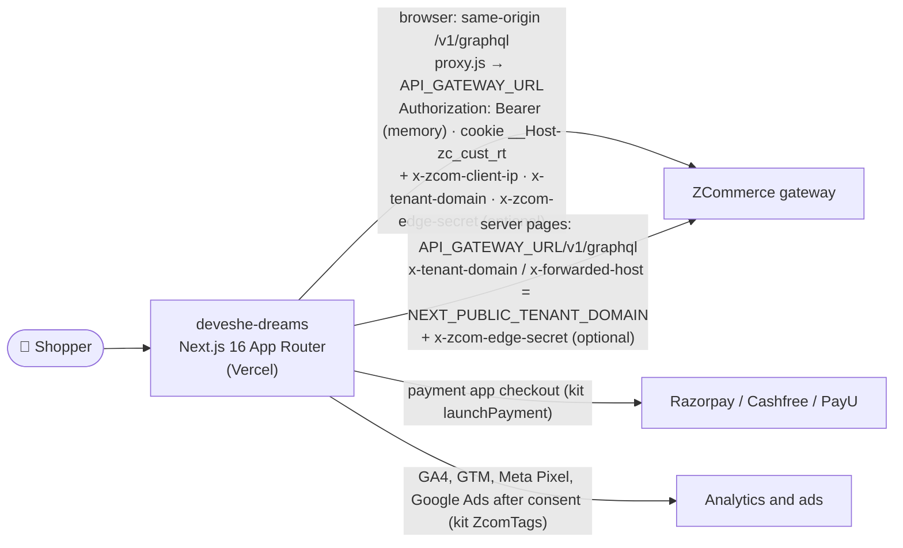
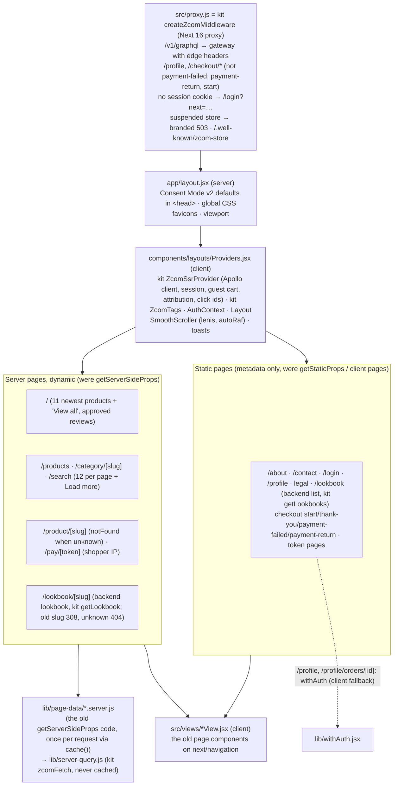
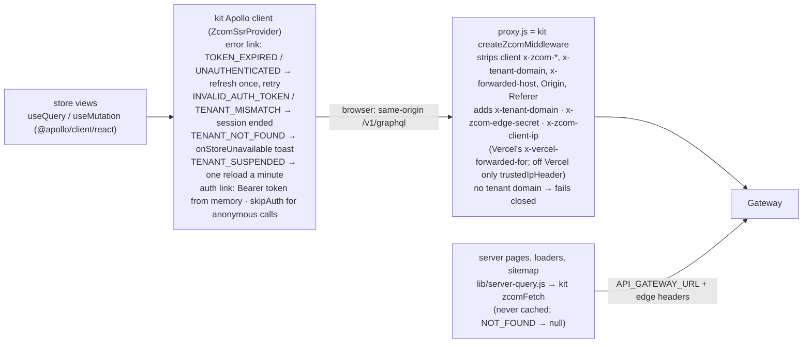
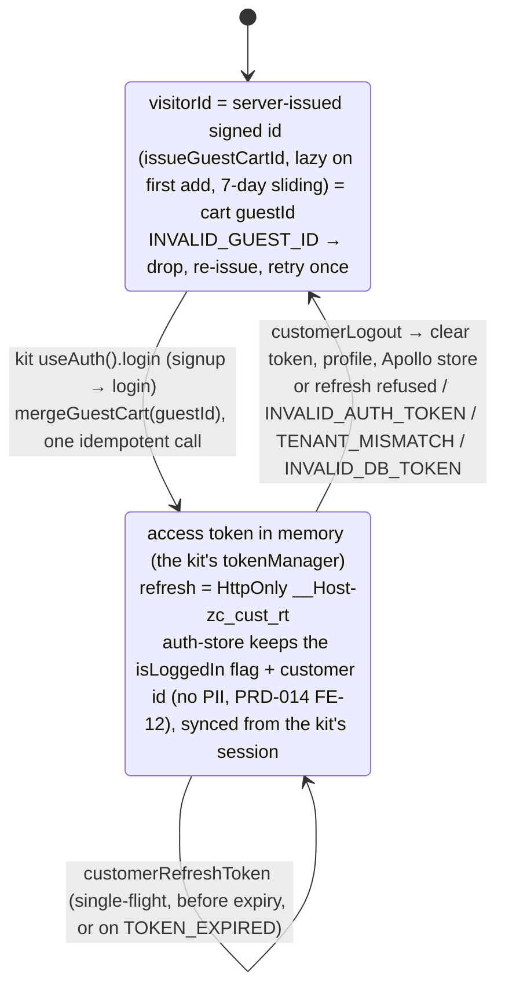
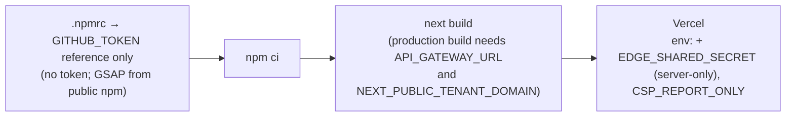

# deveshe-dreams: Solution Architecture (Deveshe Dreams storefront)

| | |
|---|---|
| **Status** | Living document. Verified against code on **2026-11-11** (App Router, ADR-001); earlier sections on **2026-10-14** (PRD-002 WS-F2, R2-W6) |
| **Parent** | Workspace `../../ARCHITECTURE.md` · `../../storefronts/CLAUDE.md` |
| **API contract** | `../../zcom-backend/docs/architecture/storefront-api-contract.md` |
| **Integration maturity** | **Current contract** (57/57 operations valid, 2026-11-11), on `@zcom/storefront-kit` v1.0.2 (kit PRD-002 step 5). Host-based tenant, same-origin API through the kit's proxy with edge headers, server-issued guest ids, cookie refresh. Not yet tested end to end |

---

## 1. Purpose and context

This is the brand storefront for Deveshe Dreams: an editorial home page, lookbooks, product pages, a cart, checkout through the store's payment app (Razorpay, Cashfree or PayU), login, and a customer profile.



## 2. Rendering architecture

App Router on Next 16 since 2026-11-11 (ADR-001, kit PRD-002 step 4); every URL is unchanged.



- **Metadata:** each page exports `metadata` or `generateMetadata` built by `lib/seo-metadata.util.js` from the page's `meta` object (the tags `SeoHeader` used to write; canonical without query or hash); `components/seo/PageSchemas.jsx` renders the JSON-LD (WebPage, organisation, site navigation, Product) in the page.
- **Errors:** `app/not-found.jsx` (404), `app/error.jsx` (branded, client), `app/global-error.jsx` (the layout itself failed).
- **Route handlers:** `/sitemap.xml`, `/robots.txt` and `/api/payments/return` (PayU form post or Cashfree redirect → 303 with a relative `Location` to `/checkout/payment-return`).

## 3. Data access

On `@zcom/storefront-kit` since 2026-11-11 (kit PRD-002 step 5): the kit owns the Apollo client, its links, the session and the proxy; the store's own documents (`graphql/`) and views use the same client.



**Edge headers (PRD-002 R2-C1).** The kit builds them in the proxy and in its server functions (`@zcom/storefront-kit/server`), the only places that read `EDGE_SHARED_SECRET`; server files import those, never a "use client" file. The gateway trusts `x-tenant-domain` and `x-zcom-client-ip` only with a valid `x-zcom-edge-secret`.

**Client IP and tenant (PRD-002 round 3, VSEC-3/VSEC-4).** On Vercel (D9) the kit takes `x-vercel-forwarded-for`; off Vercel only a header named in `trustedIpHeader` (none is set). The proxy strips client tenant headers and fails closed without `NEXT_PUBLIC_TENANT_DOMAIN`. Server page reads send the tenant and the edge secret but no `x-zcom-client-ip`; `/pay/[token]` sends the shopper's IP (`getRequestClientIp`).

**Unsubscribe (VCON-1).** `/unsubscribe` (`views/UnsubscribeView.jsx`, `noindex`) reads `?email=&token=` once, strips them from the URL (`history.replaceState`), and calls `unsubscribeNewsletter(email, token)`; the backend signs the link (`https://<tenant domain>/unsubscribe?…`) with `NEWSLETTER_TOKEN_SECRET` and answers uniformly, so the page shows one neutral message.

**Back-in-stock confirmation (PRD-020, CP-22).** A guest's `requestBackInStock` is stored unconfirmed and the backend mails a link to `/back-in-stock/confirm?token=…`. `/back-in-stock/confirm` (`views/BackInStockConfirmView.jsx`, `noindex`, disallowed in `robots.txt`) reads the token once, strips it from the URL (`history.replaceState`) and calls `confirmBackInStock(token)`: confirmed, expired-or-used, rate-limited (by `extensions.reason`) and network states. After a guest taps Notify me the toast says to check the email; signed-in shoppers keep the old copy (`utils/back-in-stock.util.js`, twin of rare `utils/back-in-stock.js`).

**Search, newsletter, reviews and SEO (PRD-014 FR-2.8).** `/search` (`noindex, follow`) renders the first page of `getClientSideProducts` with `filters.search` on the server and pages on through `ProductListing`; the footer `NewsletterForm` calls `subscribeNewsletter`; `/product/[slug]` reads the latest 10 approved reviews with the page, builds its meta from the product (merchant SEO fields win) and emits Product JSON-LD (offers, no availability until PRD-020); `app/sitemap.xml/route.js` and `app/robots.txt/route.js` are route handlers built from `Const.ClientLink`, the sitemap capped at 1000 products and cached for an hour at the edge.

**Password reset (PRD-003 FR-0.5).** `/forgot-password` (`components/login/ForgotPassword.jsx`) calls `customerRequestPasswordReset` and shows one neutral state; the emailed link opens `/reset-password` (`components/login/ResetPassword.jsx`), which reads `?token=` once, strips it from the URL (`history.replaceState`, shallow) and calls `customerResetPassword`; `INVALID_RESET_TOKEN` shows the "request a new link" state. Both pages are `noindex`.

**Operations in use (29, all ✅):** `issueGuestCartId`, `mergeGuestCart`, `customerLogin`, `customerSignup`, `customerRefreshToken`, `customerLogout`, `getMyProfile`, `updateMyProfile`; `getClientSideProducts`, `getClientSideProductById`; `getCart`, `addItemToCart`, `removeItemFromCart`, `applyCartPromotion`, `removeCartPromotion`; `createCheckoutSessionFromCart`, `getCheckoutSession`, `completeCheckout`, `createPaymentSession`, `verifyPayment`; `myOrders`, `myOrder`; `getAddresses`, `createAddress`, `updateAddress`, `deleteAddress`; `submitContactForm`, `requestBackInStock`, `unsubscribeNewsletter`; PRD-003 FR-0.5 (2026-10-15) adds `customerRequestPasswordReset`, `customerResetPassword` (31 in total). PRD-014 FR-0.8/FR-0.9 add `getClientSideCategories` and `getReviews`; FR-2.8 (2026-10-25) adds `subscribeNewsletter`, a PDP `getReviews` read and a sitemap read of `getClientSideProducts`. PRD-020 FR-13 (2026-10-26) adds `getVariantAvailability` (the fresh stock read on the PDP and the bag) and selects `availability` on products and variants; PRD-015 FR-20 adds a `myOrder` detail read and `cancelMyOrder`, `createReturnRequest`, `cancelMyReturnRequest`. 41 documents, validated with `npm run validate:ops` against the composed supergraph.

Errors are mapped to messages by `utils/api-error.util.js` from `extensions.reason` / `code` (including `CHECKOUT_EXPIRED`, `RESERVATION_RELEASED`, `INVALID_QTY`, `TOO_MANY_LINES`, `ORDER_CANCELLED`, `INVALID_GUEST_ID`, `TENANT_NOT_FOUND`). A refresh that fails for a transient reason keeps the session; only session-ending codes clear it (RBUG-19).

## 4. Session and guest identity



Since the kit (2026-11-11), its `migrateLegacyStorage` moves the pre-kit keys once (sign-in hint, guest bag id, consent, click ids), so returning shoppers keep their session, bag and consent. Unsigned guest UUIDs from before round 2 are dropped on read. After login, `?next=` is followed only when it resolves same-origin (`utils/redirect.util.js`, RSEC-6); otherwise the shopper lands on `/`.

## 5. Checkout flow

Both checkouts run on the kit's `useCheckout()` (kit 1.1.0, backend PRD-041 FR-17): the signed-in `CustomerCheckout` (`views/CheckoutView.jsx`) with `start` → `pay` / `retryPayment`, the guest checkout (`components/checkout/GuestCheckout.jsx`) with `startGuest` → `pay`. Both follow one flow (owner, 2026-11-12): "Continue to payment" reserves and shows the final total, "Pay now" is enabled only while the session is reserved for exactly the bag, coupon and details on screen (`isReservedFor`), and a closed window gives "Pay again". The ads begin checkout is sent once per page load on both paths (`hooks/useAdsBeginCheckout.jsx`). The signed-in path:

```mermaid
sequenceDiagram
    autonumber
    actor S as Shopper (signed in)
    participant P as /checkout (CustomerCheckout)
    participant K as kit useCheckout
    participant GW as Gateway
    participant NB as Payment app (Razorpay / Cashfree / PayU / CCAvenue / Nimbbl)
    participant ST as /orders/status/[token] (else thank-you)

    S->>P: "Continue to payment" (zod CheckoutSchema)
    P->>K: start({cartId, lines, email, shippingAddress, billingAddress})
    Note over K: kept unpaid order with the same fingerprint<br/>(PendingOrderStore: cart, lines, email, addresses)<br/>→ its session, no new hold
    K->>GW: createCheckoutSessionFromCart (+ attribution, consent)
    loop every 1 s, up to 45 s
        K->>GW: getCheckoutSession
    end
    K-->>P: session.pricing (shown; begin_checkout, add_shipping_info)
    S->>P: "Pay now" (enabled only while reserved for these exact details)
    P->>K: pay()
    K->>GW: completeCheckout → orderId (kept in PendingOrderStore)
    Note over K: pricing.total = 0 → PAID at once (COM-08), no payment
    K->>GW: createPaymentSession({orderId}) → checkout (SDK / REDIRECT / FORM_POST)
    K->>NB: launchPayment (known payment hosts only; add_payment_info)
    NB-->>K: result, or the redirect back through /api/payments/return → usePaymentReturn
    K->>GW: verifyPayment, then myOrder until PAID (60 s)
    K-->>P: paid + statusToken (ads purchase sent, kept order forgotten)
    P->>ST: orderStatusPath(statusToken), else /checkout/thank-you?orderId=…
    Note over P: dismissed → toast, "Pay again" (retryPayment; the kit sends checkout_error)<br/>failed with a kept order → /checkout/payment-failed?orderId=… (retryPayment)<br/>stock, price, coupon, address → message beside the button
```

A retry reuses the same unpaid order, also after a reload (the kit's `PendingOrderStore`, this tab, 2 h): its saved address is preselected and its pricing shown. A changed email or address places a new order (the backend cancels the old one, PRD-015 FR-14); a changed bag or coupon drops the kept order and the confirmation, so the charged total is never stale (RBUG-9); the coupon controls are locked while the kit places or pays (RBUG-15). The thank-you fallback polls `myOrder` and never shows success without PAID (RBUG-20); it sends only the ads purchase (deduplicated per order by the kit), and GA4's `purchase` is server-side (backend PRD-012). `SHIPPING_UNAVAILABLE` (no shipping zone for the address) is shown beside the buttons and scrolls to the delivery step; a `VARIANT_REQUIRED` cart remove refetches the bag.

## 6. Presentation layer

| Concern | Implementation |
|---|---|
| Styling | Global CSS in `styles/` (page sheets imported in `app/layout.jsx`) + a few `*.module.css`. MUI, emotion and styled-components removed |
| Fonts | `@font-face` in `globals.css` |
| Motion | GSAP 3.15 from the public npm registry (ScrollTrigger, SplitText, ScrollToPlugin) registered per component, each cleaning up only its own timelines; `lenis` 1.3 (its own `autoRaf` loop) in `SmoothScroller`, resized by a `ResizeObserver` |
| 3D | `PhoneModal` (three 0.187 / R3F 9 / drei 10), dynamic import with `ssr: false` in the contact view |
| Media | Swiper; `next/image` with a `remotePatterns` allowlist (asset domains, the platform media CDN `media.zerrorstudios.com` / `media-uat.zerrorstudios.com` (PRD-039) + `IMAGE_REMOTE_HOSTS`); product cards pass real dimensions and `sizes` (RPERF-12) |
| SEO | `generateMetadata` / `metadata` from `lib/seo-metadata.util.js` + `PageSchemas` (JSON-LD components serialised with `toJsonLd`) |
| CMS HTML | `utils/sanitize-html.util.js` allowlist (no scripts, handlers, `javascript:` URLs, iframes or svg; every link gets `rel="noopener noreferrer"`; styles with `\` dropped, RSEC-11) |
| Security headers | The kit's `buildSecurityHeaders` (`next.config.mjs`): CSP for the payment apps, GTM/GA, the Meta and Google ad tags, the platform media CDN, S3 uploads and the store's asset hosts, `frame-ancestors 'none'`; nosniff, Referrer-Policy, X-Frame-Options, Permissions-Policy, HSTS in production. `script-src 'unsafe-inline'` is kept (SF-9 partial: a nonce would make every static page dynamic, and GTM custom-HTML tags need it); `CSP_REPORT_ONLY=true` switches to report-only for rollout |
| Analytics | Consent first (PRD-014 FR-1.9, D10) on the kit: `app/layout.jsx` runs the kit's `CONSENT_DEFAULT_SCRIPT` (Consent Mode v2 "denied", then the stored choice); `components/common/ConsentBanner.jsx` saves through the kit's `updateConsent`, and the kit's `ZcomTags` loads GA4/GTM after "analytics" and the Meta Pixel / Google Ads after "marketing" (ids from `storefrontTrackingConfig`, GA4 and GTM env fallback); reopened from the footer "Cookie Preferences". `utils/analytics.js` (`trackEcomEvent`: GA4 through the kit's `trackEvent`, ads through its ads functions), `utils/analytics-events.util.js` (PRD-013 event layer; `item_id` = variant SKU); attribution and click ids are captured and sent by the kit (PRD-012, PRD-034) |

## 7. Build and dependencies



`react-tooltip` and `cross-fetch` were removed (RMAINT-9), and the lockfile no longer lists MUI/emotion/styled-components.

## 8. Gaps

| # | Gap | Path |
|---|---|---|
| 1 | Backend gaps: password change, account deactivation (the stock signal exists since PRD-020 and is off per store until the owner enables it) | Backend T1 PRDs (contract doc §2) |
| 2 | Old GSAP token (in git history; `.npmrc` holds none since 2026-11-11) and old `NEXT_PUBLIC_DB_TOKEN` need rotation | Owner (PRD-002 §7) |
| 3 | Strict tenant mode is off until `EDGE_SHARED_SECRET` is set; meanwhile the backend's per-IP login bucket sees every shopper as this host's IP | Code done (R2-C1); owner sets it here, on EB and on the CloudFront origin header at the same moment, in the same deploy as backend round 3, and confirms the host's client IP source |
| 4 | Store code still duplicated with rare-element (error copy, sanitiser, checkout view; "Keep in sync" headers, RMAINT-7); the plumbing is shared through `@zcom/storefront-kit` since 2026-11-11 | Backend ADR-010, kit PRD-002 |
| 5 | No ESLint config, no tests, no end-to-end checkout run | T2 / owner sandbox run |
| 6 | ~~Router choice: Pages Router vs App Router~~ | Done: App Router, ADR-001 (2026-11-11) |
| 7 | Every browser API call runs through the proxy (VPERF-4; Node runtime since Next 16); `'unsafe-inline'` in the CSP (SF-9) | Accepted (R3-D7) |

## PRD-014 Wave 0 (2026-10-25)

- **Catalog (FR-0.8, UX-01):** `/products` and `/category/[slug]` (`components/listing/ProductListing.jsx`) page through `getClientSideProducts` (12 per page, Load more); the category comes from `getClientSideCategories(filter: { slug })`. The home `#shop` reads the 11 newest published products (no hard-coded category) and links to `/products`; failures render an error state, never an endless skeleton. PDP related products come from the product's own category.
- **Checkout (UX-02, UX-03, W0V-C-03, W0V2-02):** the kept order's saved address (on a retry), else the primary one, is preselected; validation errors are visible outside the hidden form and at the "Pay now" button; a checkout session (15-minute stock hold) is opened only when the shopper presses "Show final total" at the shipping step or "Pay now" (never on page load, a preselected address or typing), and the summary and shipping then show its server `pricing`; "Pay now" with unchanged details reuses that same active session (R2-C8), and changed details need a new confirmation. Without pricing: "Total before shipping" (or "Estimated total" with free shipping) and shipping "Calculated at payment". A reload or retry shows the kept order's session pricing (in `pending-order.util.js` then; the kit's `PendingOrderStore` since 2026-11-12). Since 2026-11-12 "Show final total" and the self-starting "Pay now" are replaced by "Continue to payment" → "Pay now" (§5).
- **PDP (UX-09):** a missing option combination, an ARCHIVED variant or `PRODUCT_UNAVAILABLE` shows "Unavailable / Notify me".
- **Payment failed (FR-0.12, UX-04):** "Retry payment" returned to the kept unpaid order's checkout (`PendingOrder.findCartId`; since 2026-11-12 it pays the kit's kept order in place with `retryPayment`), "Back to cart" opens the drawer.
- **Home reviews (UX-35):** approved `getReviews` only; the section is hidden when there are none.
- Details and verification: `../prd/PRD-014-production-readiness-remediation.md`.

## PRD-020 stock signal and PRD-015 post-purchase (2026-10-26, not browser-tested)

- **Stock (FR-13, FR-14):** `utils/stock-signal.util.js` (twin of rare `utils/stock-signal.js`) maps the nullable `availability` / `availableQuantity` to states; `null` is today's behaviour everywhere. `utils/catalog.util.js` `isVariantUnavailable` keeps the ARCHIVED rule and adds OUT_OF_STOCK. The PDP reads the SSR value, then `hooks/useVariantAvailability.jsx` (`getVariantAvailability`, ≤ 50 ids, never cached server-side) on mount and on a variant change; a failed read keeps the SSR value. Sold-out size and colour choices are struck through (`aria-label="<value>, sold out"`, still selectable); a sold-out selection shows "Sold out" + "Notify me" (also in the mobile bag bar; an email field for guests, no login); `LOW_STOCK` shows "Only N left" (opt-in count) or "Low stock". Product cards (`/products`, `/category/[slug]`, home, related) show "Sold out" / "Low stock" badges from `Product.availability`; the store's `SHOW | SORT_LAST | HIDE` is applied by the server. The bag re-reads on open: a sold-out line shows "Sold out" (Remove stays) and checkout is held with "Remove sold-out items to continue". JSON-LD `offers.availability` comes from the rollup (`utils/product-offers.util.js`). `select_variant.in_stock` uses the signal when non-null.
- **Post-purchase (FR-20):** new `/profile/orders/[id]` (`app/profile/orders/[id]/page.jsx`, `views/OrderDetailView.jsx` + `components/profileNew/order/OrderDetail.jsx`, `withAuth`, client data): the server's `displayStatus`, a tracking block (`shipment { courier awb trackingUrl tracking }`; https only; the latest five scans), Cancel when `canCancel` (inline confirmation, `cancelMyOrder`), "Request a return" while `returnableItems` is non-empty (per-line steppers capped at `returnableQty`, reason, condition, return-by date, link to `/shipping-returns`; `createReturnRequest` with line ids) and the order's `returnRequests` with "Withdraw" on a REQUESTED one. The profile order table shows `displayStatus` and a "View" link instead of the hard-coded Shiprocket link. Helpers in `utils/order-detail.util.js`; every refusal reason is mapped in `utils/api-error.util.js` (also PRD-016 `STORE_ORDERS_PAUSED`).
- Tests: `test/stock-signal.test.mjs`, `test/order-detail.test.mjs`.
