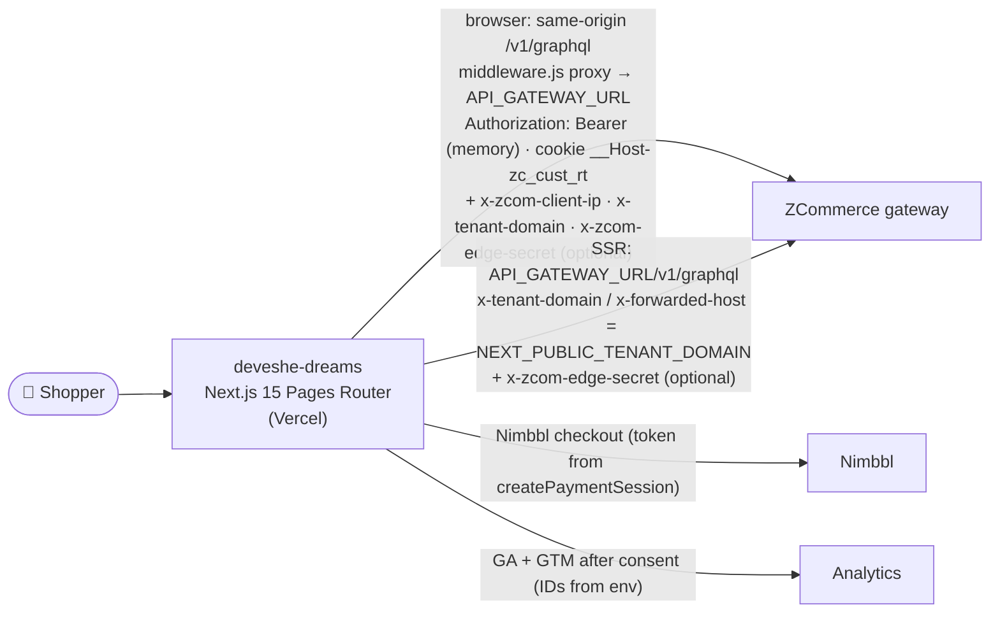
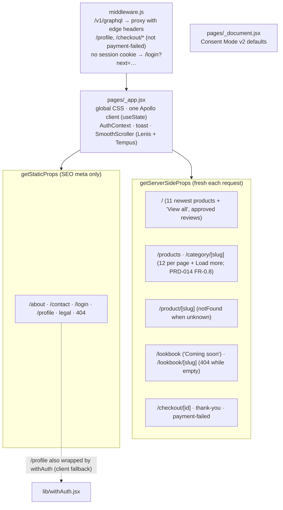
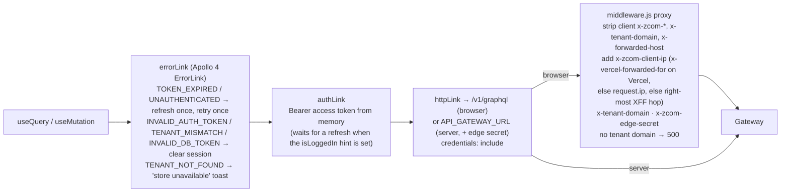
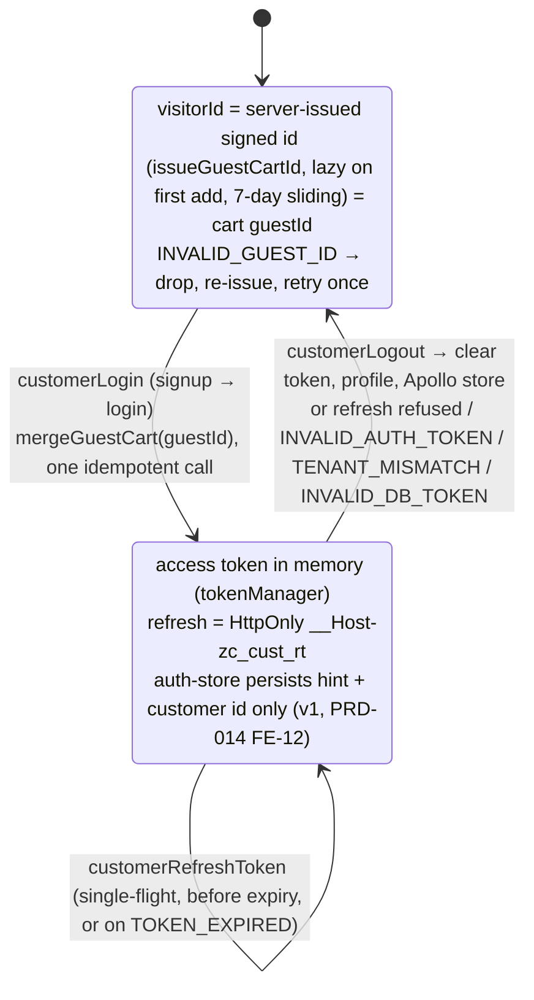
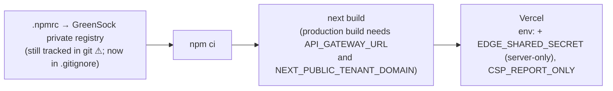

# deveshe-dreams: Solution Architecture (Deveshe Dreams storefront)

| | |
|---|---|
| **Status** | Living document. Verified against code on **2026-10-14** (after the PRD-002 WS-F2 migration and round 2, R2-W6) |
| **Parent** | Workspace `../../ARCHITECTURE.md` · `../../storefronts/CLAUDE.md` |
| **API contract** | `../../zcom-backend/docs/architecture/storefront-api-contract.md` |
| **Integration maturity** | **Current contract** (29/29 operations valid). Host-based tenant, same-origin API proxied by middleware with edge headers, server-issued guest ids, cookie refresh. Not yet tested end to end |

---

## 1. Purpose and context

This is the brand storefront for Deveshe Dreams: an editorial home page, lookbooks, product pages, a cart, Nimbbl checkout, login, and a customer profile.



## 2. Rendering architecture



## 3. Data access



**Edge headers (PRD-002 R2-C1).** `lib/edge-headers.server.js` (server-only; never imported by browser code) builds them. The gateway trusts `x-tenant-domain` and `x-zcom-client-ip` only with a valid `x-zcom-edge-secret`; until `EDGE_SHARED_SECRET` is set here and on the gateway, it runs in legacy mode. A `next.config.mjs` rewrite can't set request headers, so the proxy lives in `middleware.js`.

**Client IP and tenant (PRD-002 round 3, VSEC-3/VSEC-4).** `getClientIp` takes `x-vercel-forwarded-for` only when `VERCEL` is set, then `request.ip`, then the right-most `x-forwarded-for` hop; the first hop and `x-real-ip` are never trusted. The proxy strips client `x-tenant-domain` and `x-forwarded-host` and fails closed (500) without `NEXT_PUBLIC_TENANT_DOMAIN`. `getServerSideProps` calls (`/`, `/products`, `/category/[slug]`, `/product/[slug]`; catalog reads through `lib/catalog-listing.server.js`) send the tenant and the edge secret but no `x-zcom-client-ip`. The backend's 30/min per-IP login bucket across tenants (`AUTH_IP_RATE_LIMIT_PER_MIN`) makes setting `EDGE_SHARED_SECRET` in the same deploy as backend round 3 necessary.

**Unsubscribe (VCON-1).** `pages/unsubscribe/index.jsx` (`noindex`) reads `?email=&token=` once, strips them from the URL (`router.replace`), and calls `unsubscribeNewsletter(email, token)`; the backend signs the link (`https://<tenant domain>/unsubscribe?…`) with `NEWSLETTER_TOKEN_SECRET` and answers uniformly, so the page shows one neutral message.

**Back-in-stock confirmation (PRD-020, CP-22).** A guest's `requestBackInStock` is stored unconfirmed and the backend mails a link to `/back-in-stock/confirm?token=…`. `pages/back-in-stock/confirm.jsx` (`noindex`, disallowed in `robots.txt`) reads the token once, strips it from the URL (`router.replace`) and calls `confirmBackInStock(token)`: confirmed, expired-or-used, rate-limited (by `extensions.reason`) and network states. After a guest taps Notify me the toast says to check the email; signed-in shoppers keep the old copy (`utils/back-in-stock.util.js`, twin of rare `utils/back-in-stock.js`).

**Search, newsletter, reviews and SEO (PRD-014 FR-2.8).** `pages/search/index.jsx` (`noindex, follow`) renders the first page of `getClientSideProducts` with `filters.search` on the server and pages on through `ProductListing`; the footer `NewsletterForm` calls `subscribeNewsletter`; `/product/[slug]` reads the latest 10 approved reviews with the page, builds its meta from the product (merchant SEO fields win) and emits Product JSON-LD (offers, no availability until PRD-020); `pages/sitemap.xml.js` and `pages/robots.txt.js` are server-rendered from `Const.ClientLink`, the sitemap capped at 1000 products and cached for an hour at the edge.

**Password reset (PRD-003 FR-0.5).** `pages/forgot-password.jsx` (`components/login/ForgotPassword.jsx`) calls `customerRequestPasswordReset` and shows one neutral state; the emailed link opens `pages/reset-password.jsx` (`components/login/ResetPassword.jsx`), which reads `?token=` once, strips it from the URL (`router.replace`, shallow) and calls `customerResetPassword`; `INVALID_RESET_TOKEN` shows the "request a new link" state. Both pages are `noindex`.

**Operations in use (29, all ✅):** `issueGuestCartId`, `mergeGuestCart`, `customerLogin`, `customerSignup`, `customerRefreshToken`, `customerLogout`, `getMyProfile`, `updateMyProfile`; `getClientSideProducts`, `getClientSideProductById`; `getCart`, `addItemToCart`, `removeItemFromCart`, `applyCartPromotion`, `removeCartPromotion`; `createCheckoutSessionFromCart`, `getCheckoutSession`, `completeCheckout`, `createPaymentSession`, `verifyPayment`; `myOrders`, `myOrder`; `getAddresses`, `createAddress`, `updateAddress`, `deleteAddress`; `submitContactForm`, `requestBackInStock`, `unsubscribeNewsletter`; PRD-003 FR-0.5 (2026-10-15) adds `customerRequestPasswordReset`, `customerResetPassword` (31 in total). PRD-014 FR-0.8/FR-0.9 add `getClientSideCategories` and `getReviews`; FR-2.8 (2026-10-25) adds `subscribeNewsletter`, a PDP `getReviews` read and a sitemap read of `getClientSideProducts`. PRD-020 FR-13 (2026-10-26) adds `getVariantAvailability` (the fresh stock read on the PDP and the bag) and selects `availability` on products and variants; PRD-015 FR-20 adds a `myOrder` detail read and `cancelMyOrder`, `createReturnRequest`, `cancelMyReturnRequest`. 41 documents, validated with `npm run validate:ops` against the composed supergraph.

Errors are mapped to messages by `utils/api-error.util.js` from `extensions.reason` / `code` (including `CHECKOUT_EXPIRED`, `RESERVATION_RELEASED`, `INVALID_QTY`, `TOO_MANY_LINES`, `ORDER_CANCELLED`, `INVALID_GUEST_ID`, `TENANT_NOT_FOUND`). A refresh that fails for a transient reason keeps the session; only session-ending codes clear it (RBUG-19).

## 4. Session and guest identity



On first load of this version, old localStorage tokens and the legacy JS `refresh_token` cookie are deleted once, so existing shoppers log in again once. Unsigned guest UUIDs from before round 2 are dropped on read, so old guest bags are lost once. After login, `?next=` is followed only when it resolves same-origin (`utils/redirect.util.js`, RSEC-6); otherwise the shopper lands on `/`.

## 5. Checkout flow

```mermaid
sequenceDiagram
    autonumber
    actor S as Shopper (logged in)
    participant P as pages/checkout/[id]
    participant GW as Gateway
    participant NB as Nimbbl
    participant TY as thank-you

    S->>P: submit address (zod CheckoutSchema)
    Note over P: pending order in sessionStorage with a matching<br/>cart + coupon fingerprint and details fingerprint<br/>(email, shipping, billing) → skip to createPaymentSession
    P->>GW: createCheckoutSessionFromCart (server reuses the active session for an unchanged cart)
    loop every 1 s, up to 20 times
        P->>GW: getCheckoutSession
    end
    Note over P: RESERVED → continue; FAILED / EXPIRED → error message
    P->>GW: completeCheckout → orderId + pricing.total (saved as the pending order)
    Note over P: pricing.total = 0 → the order is already PAID (PRD-014 COM-08):<br/>no payment session, straight to thank-you
    P->>GW: createPaymentSession({orderId}) → token
    P->>NB: Checkout({token}).open()
    NB-->>P: callback (handled once per modal)
    P->>GW: verifyPayment(payload; providerOrderId from the session if missing)
    P->>TY: redirect
    loop up to 60 s
        TY->>GW: myOrder(orderId)
    end
    Note over TY: PAID → GA purchase (once per order) and countdown<br/>polling → "confirming"; missing or still unpaid → "not confirmed yet" (never a false success)
```

A retry reuses the same unpaid order, also after a reload (`utils/pending-order.util.js`, RBUG-8). A changed bag or coupon drops the pending order and starts a new one, so the charged total is never stale (RBUG-9); the coupon controls are locked while an order is placed or paid, and the pay button stays disabled until the Nimbbl callback or close (RBUG-15). Failures go to `payment-failed`. Guests are sent to login first. PRD-014 Wave 1: a ₹0 order skips the payment steps; `SHIPPING_UNAVAILABLE` (no shipping zone for the address) is shown at the pricing step or the "Pay now" button and scrolls to the delivery step; a `VARIANT_REQUIRED` cart remove refetches the bag.

## 6. Presentation layer

| Concern | Implementation |
|---|---|
| Styling | Global CSS in `styles/` (page sheets imported in `_app.jsx`) + a few `*.module.css`. MUI, emotion and styled-components removed |
| Fonts | `@font-face` in `globals.css` |
| Motion | GSAP **business** (`gsap` aliased to `@gsap/business`; ScrollTrigger, SplitText, ScrollToPlugin) registered per component, each cleaning up only its own timelines; Lenis + Tempus in `SmoothScroller`, resized by a `ResizeObserver` |
| 3D | `PhoneModal` (three / R3F), dynamic import with `ssr: false` |
| Media | Swiper; `next/image` with a `remotePatterns` allowlist (asset domains + `IMAGE_REMOTE_HOSTS`); product cards pass real dimensions and `sizes` (RPERF-12) |
| SEO | `SeoHeader` + JSON-LD schema components serialised with `toJsonLd` |
| CMS HTML | `utils/sanitize-html.util.js` allowlist (no scripts, handlers, `javascript:` URLs, iframes or svg; every link gets `rel="noopener noreferrer"`; styles with `\` dropped, RSEC-11) |
| Security headers | CSP (GTM/GA, `*.nimbbl.tech`, asset hosts, `frame-ancestors 'none'`), nosniff, Referrer-Policy, X-Frame-Options, Permissions-Policy, HSTS in production (`next.config.mjs`). `script-src 'unsafe-inline'` is kept (SF-9 partial: a nonce would make every static page dynamic, and GTM custom-HTML tags need it); `CSP_REPORT_ONLY=true` switches to report-only for rollout |
| Analytics | Consent first (PRD-014 FR-1.9, D10): `_document.jsx` runs only the Google Consent Mode v2 defaults ("denied"); `components/common/ConsentBanner.jsx` + `utils/consent.util.js` load GA and GTM after "analytics" consent, choice in localStorage `zc_consent`, reopened from the footer "Cookie Preferences"; IDs from env, no defaults. `utils/analytics.js` (`trackEcomEvent`, the GA4 e-commerce events), `utils/analytics-events.util.js` (PRD-013 event layer: `select_item`, `select_variant`, `cta_click`, `gallery_interaction`, `size_guide_open`, `notify_me`, `coupon_apply`/`coupon_failed`, `add_shipping_info`, `add_payment_info`, `checkout_error`; `item_id` = variant SKU), `utils/ga-attribution.util.js` (PRD-012 order attribution) |

## 7. Build and dependencies



`react-tooltip` and `cross-fetch` were removed (RMAINT-9), and the lockfile no longer lists MUI/emotion/styled-components.

## 8. Gaps

| # | Gap | Path |
|---|---|---|
| 1 | Backend gaps: lookbook, password change, account deactivation (the stock signal exists since PRD-020 and is off per store until the owner enables it) | Backend T1 PRDs (contract doc §2) |
| 2 | `.npmrc` still tracked; GSAP token and old `NEXT_PUBLIC_DB_TOKEN` need rotation | Owner (PRD-002 §7) |
| 3 | Strict tenant mode is off until `EDGE_SHARED_SECRET` is set; meanwhile the backend's per-IP login bucket sees every shopper as this host's IP | Code done (R2-C1); owner sets it here, on EB and on the CloudFront origin header at the same moment, in the same deploy as backend round 3, and confirms the host's client IP source |
| 4 | Shared logic duplicated with rare-element (files carry "Keep in sync" headers, RMAINT-7) | ADR for a shared package |
| 5 | No ESLint config, no tests, no end-to-end checkout run | T2 / owner sandbox run |
| 6 | Router choice: Pages Router vs App Router | ADR |
| 7 | Every browser API call runs through the Edge middleware (VPERF-4); `'unsafe-inline'` in the CSP (SF-9) | Accepted (R3-D7) |

## PRD-014 Wave 0 (2026-10-25)

- **Catalog (FR-0.8, UX-01):** `/products` and `/category/[slug]` (`components/listing/ProductListing.jsx`) page through `getClientSideProducts` (12 per page, Load more); the category comes from `getClientSideCategories(filter: { slug })`. The home `#shop` reads the 11 newest published products (no hard-coded category) and links to `/products`; failures render an error state, never an endless skeleton. PDP related products come from the product's own category.
- **Checkout (UX-02, UX-03, W0V-C-03, W0V2-02):** the kept order's saved address (on a retry), else the primary one, is preselected; validation errors are visible outside the hidden form and at the "Pay now" button; a checkout session (15-minute stock hold) is opened only when the shopper presses "Show final total" at the shipping step or "Pay now" (never on page load, a preselected address or typing), and the summary and shipping then show its server `pricing`; "Pay now" with unchanged details reuses that same active session (R2-C8), and changed details need a new confirmation. Without pricing: "Total before shipping" (or "Estimated total" with free shipping) and shipping "Calculated at payment". A reload or retry re-reads the kept order's session pricing (`checkoutId` in `pending-order.util.js`).
- **PDP (UX-09):** a missing option combination, an ARCHIVED variant or `PRODUCT_UNAVAILABLE` shows "Unavailable / Notify me".
- **Payment failed (FR-0.12, UX-04):** "Retry payment" returns to the kept unpaid order's checkout (`PendingOrder.findCartId`), "Back to cart" opens the drawer.
- **Home reviews (UX-35):** approved `getReviews` only; the section is hidden when there are none.
- Details and verification: `../prd/PRD-014-production-readiness-remediation.md`.

## PRD-020 stock signal and PRD-015 post-purchase (2026-10-26, not browser-tested)

- **Stock (FR-13, FR-14):** `utils/stock-signal.util.js` (twin of rare `utils/stock-signal.js`) maps the nullable `availability` / `availableQuantity` to states; `null` is today's behaviour everywhere. `utils/catalog.util.js` `isVariantUnavailable` keeps the ARCHIVED rule and adds OUT_OF_STOCK. The PDP reads the SSR value, then `hooks/useVariantAvailability.jsx` (`getVariantAvailability`, ≤ 50 ids, never cached server-side) on mount and on a variant change; a failed read keeps the SSR value. Sold-out size and colour choices are struck through (`aria-label="<value>, sold out"`, still selectable); a sold-out selection shows "Sold out" + "Notify me" (also in the mobile bag bar; an email field for guests, no login); `LOW_STOCK` shows "Only N left" (opt-in count) or "Low stock". Product cards (`/products`, `/category/[slug]`, home, related) show "Sold out" / "Low stock" badges from `Product.availability`; the store's `SHOW | SORT_LAST | HIDE` is applied by the server. The bag re-reads on open: a sold-out line shows "Sold out" (Remove stays) and checkout is held with "Remove sold-out items to continue". JSON-LD `offers.availability` comes from the rollup (`utils/product-offers.util.js`). `select_variant.in_stock` uses the signal when non-null.
- **Post-purchase (FR-20):** new `/profile/orders/[id]` (`pages/profile/orders/[id].jsx` + `components/profileNew/order/OrderDetail.jsx`, `withAuth`, client data): the server's `displayStatus`, a tracking block (`shipment { courier awb trackingUrl tracking }`; https only; the latest five scans), Cancel when `canCancel` (inline confirmation, `cancelMyOrder`), "Request a return" while `returnableItems` is non-empty (per-line steppers capped at `returnableQty`, reason, condition, return-by date, link to `/shipping-returns`; `createReturnRequest` with line ids) and the order's `returnRequests` with "Withdraw" on a REQUESTED one. The profile order table shows `displayStatus` and a "View" link instead of the hard-coded Shiprocket link. Helpers in `utils/order-detail.util.js`; every refusal reason is mapped in `utils/api-error.util.js` (also PRD-016 `STORE_ORDERS_PAUSED`).
- Tests: `test/stock-signal.test.mjs`, `test/order-detail.test.mjs`.
